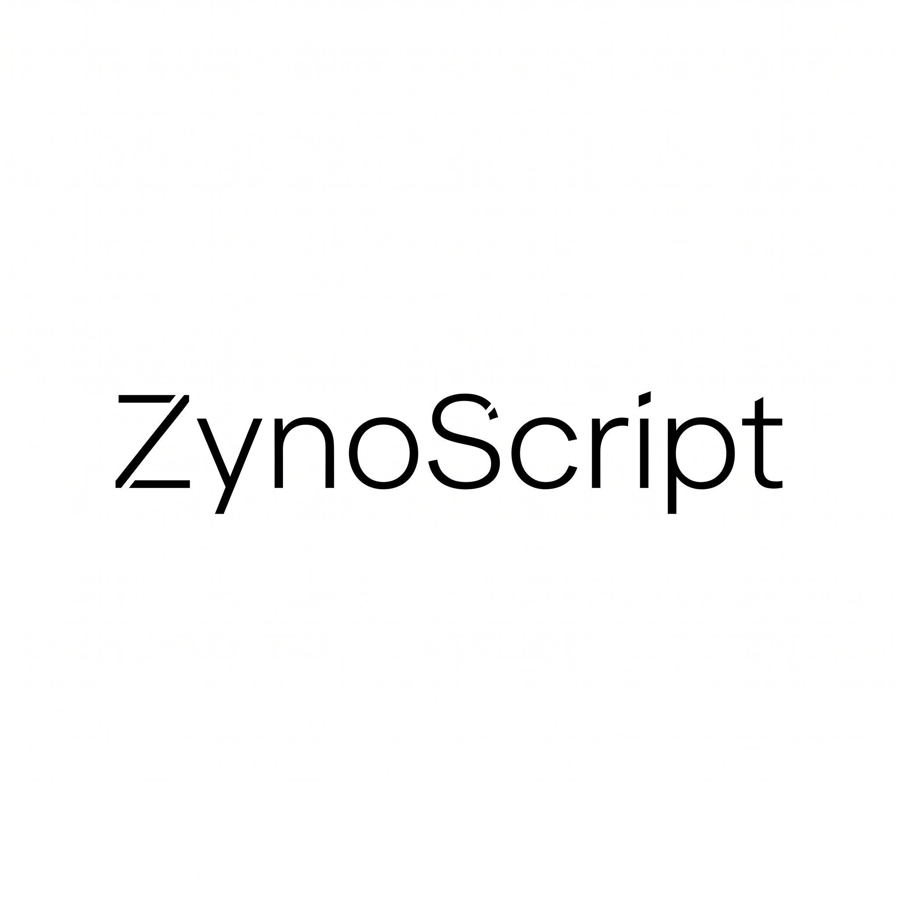
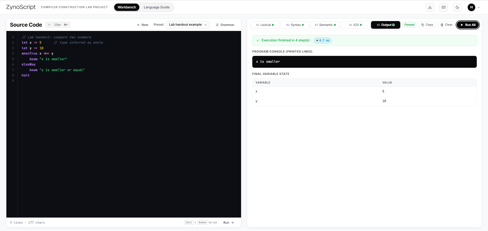
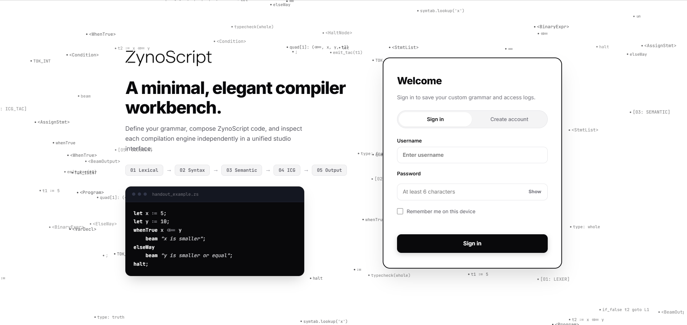
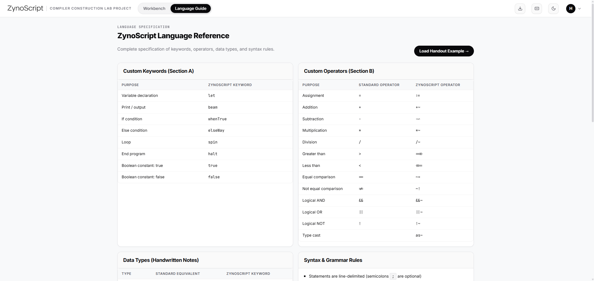

<p align="center">
  
</p>

<h1 align="center">ZynoScript Compiler Studio</h1>

<p align="center">
  <strong>A full-stack, web-based laboratory workbench for learning compiler construction with real-time pipeline stages, dynamic grammar customization, and telemetry.</strong>
</p>

<p align="center">
  <em>Built as an academic Compiler Construction Lab Project.</em>
</p>

<p align="center">
  <a href="https://your-project.vercel.app"></a>
  <a href="#-running-the-test-suite"></a>
  <a href="https://fastapi.tiangolo.com"></a>
  <a href="https://neon.tech"></a>
  <a href="https://www.python.org"></a>
  <a href="LICENSE"></a>
</p>

<p align="center">
  
</p>

---

## 👥 Authors & Credits

This project was developed for our **Compiler Construction Lab Project**:

* **Compiler Engine & Core Grammar Lead:**  
  👉 **[Syed Abdul Ali Naqvi](https://github.com/SyedAbdulAliNaqvi)**  
  Co-developed core compiler stages, lexical tokenization, recursive-descent syntax parsing, semantic verification rules, Intermediate Code Generation (Three-Address Code & Quadruple tables), and language specifications.

* **Team Lead & Full-Stack Architect:**  
  👉 **[Syed Haziq Zia](https://github.com/syedhaziqzia)**  
  Overall project leadership, backend architecture & REST APIs, cloud database systems (dual SQLite / Neon PostgreSQL), security hardening, interactive laboratory workbench UI/UX, and Vercel cloud deployment.

* **QA, Testing & Verification Support:**  
  👉 **[Muhammad Noman](https://github.com/Noman-exe)**  
  Assisted with quality assurance testing and secondary verification of compiler test cases.

---

## 🎯 What is ZynoScript?

When you write code in languages like Python, C++, or Java, the computer translates your written words into machine instructions. Usually, this translation happens invisibly behind the scenes inside a "black box"—making it difficult for students to understand what actually happens at each step.

**ZynoScript Compiler Studio** opens up that black box. It provides a visual, interactive laboratory where you can write code in a custom language called **ZynoScript** and inspect each phase of the compiler step-by-step:

1. **See How Words Are Read:** Watch raw code get broken down into individual tokens and keywords.
2. **Explore Syntax Trees:** See your code represented visually as a structured parse tree.
3. **Verify Meaning & Types:** Inspect the symbol table and see type-checking rules in action.
4. **Generate Low-Level Instructions:** Examine the generated Three-Address Code (TAC) and quadruples.
5. **Run the Program:** Watch a built-in virtual machine execute the code and display terminal output.
6. **Change Language Keywords on the Fly:** Rename any keyword (e.g. change `beam` to `print` or `whenTrue` to `if`) and watch the entire compiler instantly adapt.

---

## 📸 Interface Showcase

### 1. Welcome & Sign In
Features secure registration, session management, and ambient background floating compiler elements:

<p align="center">
  
</p>

### 2. Interactive Compiler Workbench
The main studio interface featuring source code editing with line numbers, instant stage tabs (Lexical, Syntax, Semantic, ICG, Output), terminal output, and live variable tracking:

<p align="center">
  
</p>

### 3. Language Reference & Specification
An in-app reference sheet outlining active keywords, custom operator overrides, data types, and formal grammar rules:

<p align="center">
  
</p>

---

## 🔄 The 5 Compiler Stages

Every stage lives in [`app/engines/`](app/engines/) as an independent pure Python module:

| Stage | Module | What It Does (Plain Language) | Output Produced |
|---|---|---|---|
| **01. Lexical** | `lexical.py` | Scans source text and recognizes words, numbers, and symbols | Token list, symbol table, recognized categories |
| **02. Syntax** | `syntax.py` | Checks grammar rules and builds the program structure | Abstract Syntax Tree (JSON & ASCII tree) |
| **03. Semantic** | `semantic.py` | Validates variable declarations, scopes, and data types | Symbol Table, scope hierarchy, type verification |
| **04. ICG** | `icg.py` | Translates the tree into simple, step-by-step intermediate code | Three-Address Code (TAC), Quadruple table |
| **05. VM Runtime** | `output.py` | Executes the intermediate instructions | Console output, runtime variables, steps executed |

---

## 💻 ZynoScript Syntax Quick Reference

Every valid ZynoScript program must conclude with `halt;`:

```zynoscript
let whole counter := 1;
let whole maxLimit := 5;

spin (counter <<= maxLimit) {
    whenTrue (counter ~= 3) {
        beam "Three reached!";
    } elseWay {
        beam counter;
    }
    counter := counter +~ 1;
}

beam "Execution complete.";
halt;
```

* **Data Types:** `whole` (int), `part` (float), `phrase` (str), `flag` (bool), `mark` (char)
* **Conditions & Loops:** `whenTrue (condition) { ... } elseWay { ... }`, `spin (condition) { ... }`
* **Operators:** `+~`, `-~`, `*~`, `/~` (Math) | `=>>`, `<<=`, `~=`, `~!` (Comparison)
* **Print & Finish:** `beam <expression>;` | `halt;`

---

## 🚀 Quick Start & Local Setup

### Option A: Quick Run (Direct with Global Python)

If you already have Python 3.12+ installed, you can run the studio directly:

```bash
# 1. Clone the repository
git clone https://github.com/<your-username>/zynoscript-compiler.git
cd zynoscript-compiler

# 2. Install dependencies
pip install -r requirements.txt

# 3. Start the server
uvicorn app.main:app --reload
```

### Option B: Isolated Run (Using a Virtual Environment)

If you prefer keeping dependencies inside an isolated virtual environment:

```bash
# 1. Clone the repository
git clone https://github.com/<your-username>/zynoscript-compiler.git
cd zynoscript-compiler

# 2. Create and activate a virtual environment
# Windows PowerShell:
python -m venv .venv
.venv\Scripts\Activate.ps1

# macOS / Linux:
# python3 -m venv .venv
# source .venv/bin/activate

# 3. Install dependencies
pip install -r requirements.txt

# 4. Start the server
uvicorn app.main:app --reload
```

Once running, open your browser:
* **Studio UI:** [http://127.0.0.1:8000](http://127.0.0.1:8000)
* **Interactive API Documentation:** [http://127.0.0.1:8000/docs](http://127.0.0.1:8000/docs)

---

## 🌐 Deploying to Vercel (100% Free Cloud Hosting)

This repository includes [`vercel.json`](vercel.json) ready for deployment with a free Neon PostgreSQL database:

1. Create a free PostgreSQL database at [Neon.tech](https://neon.tech) and copy your connection string (`postgresql://...`).
2. Push your repository to your GitHub account.
3. Import the repository in [Vercel](https://vercel.com).
4. In Vercel's **Settings → Environment Variables**, add:
   * `DATABASE_URL`: *(Your Neon PostgreSQL connection string)*
   * `ADMIN_USERNAME`: *(Optional: your desired administrator username)*
   * `ADMIN_PASSWORD`: *(Optional: your desired administrator password)*
5. Click **Deploy**. Vercel serves the static studio interface from edge CDN and executes compiler endpoints via serverless Python.

---

## 🛡️ Security Architecture

* **Zero Hardcoded Secrets:** No passwords, tokens, or private credentials exist in the source code.
* **Public Registration Safety:** Public registrations are strictly standard `user` accounts. Visitors cannot self-assign administrator privileges.
* **Administrator Setup:** Admin accounts are created strictly by setting `ADMIN_USERNAME` and `ADMIN_PASSWORD` in server environment variables (`.env` or Vercel dashboard).
* **SQL Injection Immunity:** 100% of database queries use parameterized placeholders (`?` / `%s`).
* **Timing-Safe Authentication:** Passwords use salted PBKDF2-HMAC-SHA256 (120,000 rounds) with constant-time comparison (`secrets.compare_digest`) and dummy hashing for non-existent users.
* **Cybersecurity HTTP Headers:** Every response includes `X-Frame-Options: DENY`, `X-Content-Type-Options: nosniff`, `X-XSS-Protection: 1; mode=block`, and `Referrer-Policy: strict-origin-when-cross-origin`.
* **Input Flood Prevention:** Code submissions are bounded by `MAX_SOURCE_CHARS` (20,000 characters) to prevent memory exhaustion.

---

## 🧪 Running the Test Suite

Run the automated integration and unit test suite (40 tests covering engines, authentication, authorization, security headers, and permission boundaries):

```bash
python -m unittest discover tests
```

---

## 📁 Project Structure

```text
zynoscript-compiler/
├── app/
│   ├── main.py                  # FastAPI entry point, CORS, security headers & static mount
│   ├── config.py                # Environment-driven settings & security boundaries
│   ├── db.py                    # Dual SQLite (local) / PostgreSQL (cloud) database manager
│   ├── auth.py                  # PBKDF2 password hashing & session management
│   ├── logs.py                  # Activity telemetry recording and audit queries
│   ├── pipeline.py              # 5-stage compiler pipeline orchestrator
│   ├── engines/                 # Pure compiler modules (zero web dependencies)
│   │   ├── grammar.py           # Grammar rules, validation & BNF generator
│   │   ├── lexical.py           # Tokenizer & symbol table scanner
│   │   ├── syntax.py            # Recursive-descent AST parser
│   │   ├── semantic.py          # Type verification & scope hierarchy rules
│   │   ├── icg.py               # TAC (Three-Address Code) & quadruples generator
│   │   └── output.py            # AST interpreter & virtual machine runtime
│   └── routes/                  # REST API routes (auth, compiler, grammar, logs, admin)
├── api/
│   └── index.py                 # Vercel serverless function entry point
├── public/                      # Static studio frontend (HTML, CSS, JS, Assets)
├── tests/                       # 40 automated unit & integration tests
├── data/                        # Local SQLite database directory
├── .env.example                 # Configuration template
├── vercel.json                  # Vercel routing configuration
├── requirements.txt             # Minimal Python dependencies
└── README.md                    # Project documentation
```

---

## 🎓 Group Members

| # | Member Name | Role / Area of Contribution | GitHub Profile |
|---|---|---|---|
| 1 | **Syed Haziq Zia** | **Team Lead** — Full-Stack & Backend Architecture, UI/UX, Security & Cloud Deployment | [@syedhaziqzia](https://github.com/syedhaziqzia) |
| 2 | **Syed Abdul Ali Naqvi** | **Compiler Lead** — Core Compiler Engines, Grammar Design & Intermediate Code | [@SyedAbdulAliNaqvi](https://github.com/SyedAbdulAliNaqvi) |
| 3 | **Muhammad Noman** | Documentation & Testing Support | [@Noman-exe](https://github.com/Noman-exe) |

---

## 📄 License

This project is licensed under the [MIT License](LICENSE).

