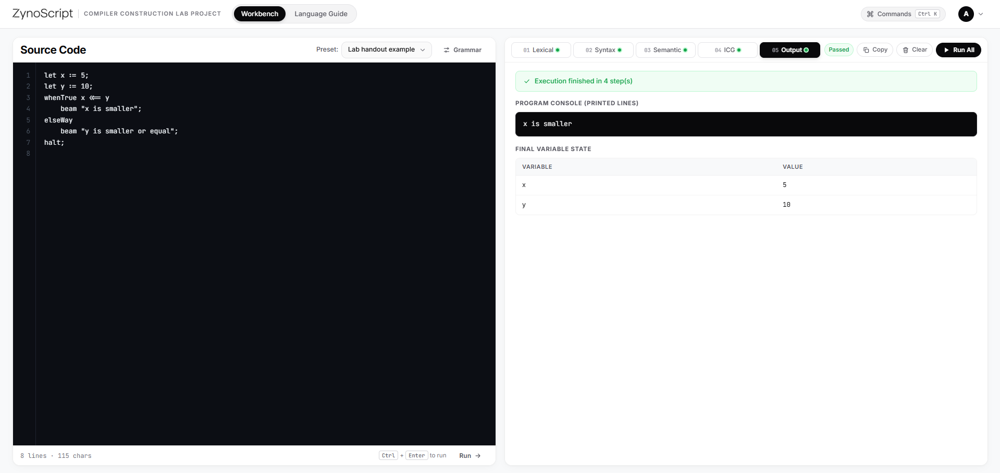
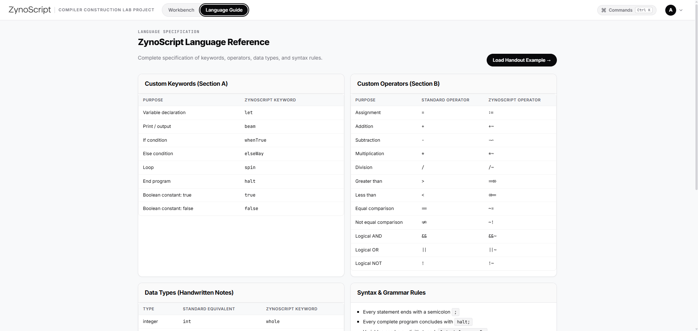
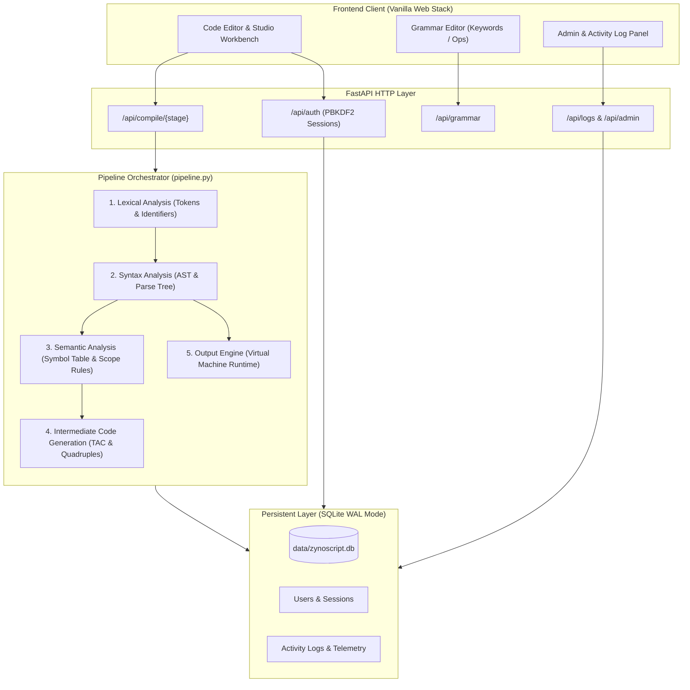

<p align="center">
  
</p>

<h1 align="center">ZynoScript Compiler Studio</h1>

<p align="center">
  <strong>A full-stack, web-based compiler construction workbench with real-time pipeline stages, dynamic grammar customization, and comprehensive telemetry.</strong>
</p>

<p align="center">
  <a href="#features"></a>
  <a href="#features"></a>
  <a href="#testing"></a>
  <a href="#production-deployment"></a>
  <a href="#production-deployment"></a>
  <a href="LICENSE"></a>
</p>

<p align="center">
  
</p>

---

## 📑 Table of Contents

- [Overview](#-overview)
- [Interface Showcase](#-interface-showcase)
- [System Architecture](#-system-architecture)
- [Key Features](#-key-features)
- [The ZynoScript Language](#-the-zynoscript-language)
  - [Language Cheat Sheet](#language-cheat-sheet)
  - [Sample Code](#sample-code)
- [Compiler Engine Contracts](#-compiler-engine-contracts)
- [Dynamic Grammar Editing](#-dynamic-grammar-editing)
- [Security & Concurrency](#-security--concurrency)
- [Project Structure](#-project-structure)
- [Quick Start](#-quick-start)
  - [Prerequisites](#prerequisites)
  - [Local Installation](#local-installation)
  - [Running the Test Suite](#running-the-test-suite)
- [Production Deployment](#-production-deployment)
  - [Deploying to Render](#deploying-to-render)
  - [Environment Variables](#environment-variables)
- [License](#-license)

---

## 💡 Overview

**ZynoScript** is a custom programming language designed for Compiler Construction. The **ZynoScript Compiler Studio** provides an interactive web-based IDE where students and developers can:

1. **Write and run ZynoScript code** with real-time feedback and diagnostic tracing.
2. **Inspect five decoupled compiler stages** independently (Lexical Analysis, Syntax Parsing, Semantic Validation, Intermediate Code Generation, and Virtual Machine / Output Interpretation).
3. **Reconfigure grammar rules dynamically** on a per-user basis without modifying a single line of backend compiler code.
4. **Monitor developer activity** via an audit logging subsystem with program hashing and telemetry.
5. **Manage users and permissions** using built-in administrative tools.

---

## 📸 Interface Showcase

### 1. Interactive Compiler Workbench
The central IDE environment featuring a dedicated source editor with line numbering, example presets, real-time stage tabs (Lexical, Syntax, Semantic, ICG, Output), an execution console, and runtime variable inspection:

<p align="center">
  
</p>

### 2. Language Reference & Specification Guide
An integrated, in-app specification sheet outlining all active keyword mappings, operator overrides, data type equivalents, and formal grammar rules:

<p align="center">
  
</p>

### 3. Welcome & Authentication Gateway
The user entry portal featuring secure registration and login, session persistence controls, sample program previews, and dynamic AST/TAC ambient background visuals:

<p align="center">
  
</p>

---

## 🏗 System Architecture

The application is built on a clean, decoupled architecture. The frontend communicates with a high-performance **FastAPI** backend, and every compiler stage operates as a pure function with strict input/output contracts.



---

## ✨ Key Features

| Component | Capabilities |
|---|---|
| **🎨 Modern Web UI** | Clean, responsive workbench with custom controls, syntax line highlighting, example programs, and zero build tool overhead. |
| **🔍 5 Independent Engines** | Run any compiler stage individually or execute the complete pipeline with stage-blocking error visualization. |
| **⚙️ Dynamic Grammar Mapping** | Rename language keywords (e.g., change `beam` to `print`) and operators per user; all compiler stages instantly adapt. |
| **🛡️ Robust Security** | Constant-time password verification (`secrets.compare_digest`), anti-enumeration protections, parameterized SQL queries, and CORS configuration. |
| **⚡ Concurrency Ready** | SQLite Write-Ahead Logging (WAL mode) with busy timeouts for seamless multi-user access without table lockups. |
| **📊 Activity Telemetry** | Full audit trail tracking compilation runs, line counts, SHA-1 program hashes, and administrative events. |
| **👑 Role-Based Access** | Automatic first-account administrator provisioning, user management, and password reset facilities. |

---

## 💻 The ZynoScript Language

ZynoScript is a statically-typed, imperative programming language. Every valid program must terminate with `halt;`.

### Language Cheat Sheet

| Category | ZynoScript Syntax | Description / Equivalent |
|---|---|---|
| **Variable Declaration** | `let <type> <id> := <val>;` | Variable declaration (`let whole x := 10;`) |
| **Types** | `whole`, `part`, `phrase`, `flag`, `mark` | `int`, `float`, `string`, `bool`, `char` |
| **Output** | `beam <expr>;` | Prints expression to console |
| **Conditional** | `whenTrue (cond) { ... } elseWay { ... }` | `if (cond) { ... } else { ... }` |
| **Loops** | `spin (cond) { ... }` | `while (cond) { ... }` |
| **Arithmetic** | `+~`, `-~`, `*~`, `/~` | Standard `+`, `-`, `*`, `/` |
| **Comparison** | `=>>` (gt), `<<=` (lt), `~=` (eq), `~!` (neq) | `>`, `<`, `==`, `!=` |
| **Boolean Logic** | `&&~`, `\|\|~`, `!~` | `&&`, `\|\|`, `!` |
| **Termination** | `halt;` | Required terminal statement |

### Sample Code

```zynoscript
let whole counter := 1;
let whole maxLimit := 5;

spin (counter <<= maxLimit) {
    whenTrue (counter ~= 3) {
        beam "Three reached!";
    } elseWay {
        beam counter;
    }
    counter := counter +~ 1;
}

beam "Execution complete.";
halt;
```

---

## 🔄 Compiler Engine Contracts

Every engine lives in [app/engines/](file:///d:/zynoscript-compiler/app/engines) as an independent pure module that imports no other engine:

| Engine | File | Input | Output |
|---|---|---|---|
| **Lexical** | `lexical.py` | `source: str, grammar: dict` | `tokens[]`, `identifiers[]`, `categories[]`, `errors[]` |
| **Syntax** | `syntax.py` | `tokens: list, grammar: dict` | `ast` (JSON), `tree` (Formatted text), `errors[]` |
| **Semantic** | `semantic.py` | `ast: list, grammar: dict` | `symbols[]` (Symbol Table), `errors[]` (Rules 1–7) |
| **ICG** | `icg.py` | `ast: list, grammar: dict` | `tac[]` (Three-Address Code), `quads[]` (Quadruples) |
| **Output** | `output.py` | `ast: list, grammar: dict` | `output[]` (Console lines), `variables[]`, `steps`, `errors[]` |

> [!NOTE]
> Engines are chained by [app/pipeline.py](file:///d:/zynoscript-compiler/app/pipeline.py). If an early stage fails (e.g. Syntax error), subsequent stages are cleanly blocked and the UI highlights the exact blocking cause.

---

## 🔒 Security & Concurrency

The project includes built-in safeguards for production and lab environments:

* **SQL Injection Prevention:** 100% of database queries use parameterized SQL (`?` placeholders).
* **Timing-Safe Auth:** Password verification utilizes `secrets.compare_digest` with dummy hash executions on unknown usernames to prevent timing-based user enumeration.
* **Brute-Force & Session Protection:** Cryptographically secure 256-bit session tokens (`secrets.token_urlsafe(32)`) with automatic session pruning.
* **High-Concurrency SQLite:** Write-Ahead Logging (`PRAGMA journal_mode = WAL;`) and busy wait timeouts prevent `database is locked` errors during simultaneous code runs.
* **Input Bounds:** Source code length is capped via `MAX_SOURCE_CHARS` (20,000 characters by default) to protect against resource exhaustion.

---

## 📁 Project Structure

```text
zynoscript-compiler/
├── app/
│   ├── main.py                  # Application entry point, CORS, routes & static mount
│   ├── config.py                # Environment-driven configuration & constants
│   ├── db.py                    # SQLite schema, WAL mode & connection manager
│   ├── auth.py                  # Cryptographic auth, PBKDF2 hashing & session guard
│   ├── logs.py                  # Telemetry recording and querying
│   ├── pipeline.py              # Pipeline chaining orchestrator
│   ├── engines/                 # Pure compiler stages (zero web dependencies)
│   │   ├── grammar.py           # Grammar rules, validation & BNF generator
│   │   ├── lexical.py           # Tokenizer & symbol scanner
│   │   ├── syntax.py            # Recursive-descent AST parser
│   │   ├── semantic.py          # Type checking, scope validation & semantic rules
│   │   ├── icg.py               # TAC and quadruples generator
│   │   └── output.py            # Abstract syntax tree interpreter / VM runtime
│   └── routes/                  # FastAPI REST endpoints
│       ├── auth.py              # User registration, login, session token validation
│       ├── compiler.py          # POST /api/compile/{stage}
│       ├── grammar.py           # Grammar read/update/reset endpoints
│       ├── logs.py              # Activity audit query endpoint
│       └── admin.py             # Administrative controls & user management
├── api/                         # Vercel serverless function entry point
│   └── index.py
├── frontend/                    # Browser-based workbench (no build step needed)
│   ├── index.html               # Single-page studio interface
│   ├── css/style.css            # Custom CSS design system
│   ├── assets/                  # Logos and application screenshots
│   │   ├── compiler-workbench.png
│   │   ├── language-reference.png
│   │   ├── welcome-auth.png
│   │   ├── wordmark.png
│   │   └── Zynoscript-Logo.jpg
│   └── js/                      # Modular client logic (api.js, app.js, samples.js)
├── tests/                       # Automated test suite
│   ├── test_api.py              # REST API & authentication integration tests
│   └── test_engines.py          # Isolated compiler engine unit tests
├── data/                        # SQLite storage directory (.gitkeep tracked)
├── .env.example                 # Environment configuration template
├── vercel.json                  # Vercel routing configuration
├── requirements.txt             # Minimal Python dependencies
└── README.md                    # Project documentation
```

---

## 🚀 Quick Start

### Prerequisites
* **Python 3.12+**
* `pip` and `venv`

### Local Installation

1. **Clone the repository:**
   ```bash
   git clone https://github.com/<your-username>/zynoscript-compiler.git
   cd zynoscript-compiler
   ```

2. **Set up a virtual environment:**
   ```bash
   # Windows (PowerShell)
   python -m venv .venv
   .venv\Scripts\Activate.ps1

   # macOS / Linux
   python3 -m venv .venv
   source .venv/bin/activate
   ```

3. **Install dependencies:**
   ```bash
   pip install -r requirements.txt
   ```

4. **Launch the development server:**
   ```bash
   uvicorn app.main:app --reload
   ```

5. **Open the studio:**
   * Studio UI: [http://127.0.0.1:8000](http://127.0.0.1:8000)
   * Interactive Swagger Docs: [http://127.0.0.1:8000/docs](http://127.0.0.1:8000/docs)

> [!TIP]
> The very first account registered on a fresh deployment is automatically promoted to **Admin** role with full access to user management and system-wide telemetry.

---

### Running the Test Suite

Execute the comprehensive test suite (27 automated tests covering engines, APIs, auth, and security boundaries):

```bash
python -m unittest discover tests
```

---

## 🌐 Production Deployment

### Deploying to Vercel (Recommended - 100% Free with Neon PostgreSQL)

This repository includes [`vercel.json`](vercel.json) and a hybrid database manager ready for serverless execution:

1. Create a free project at [Neon.tech](https://neon.tech) and copy your `DATABASE_URL`.
2. Push this repository to your GitHub account.
3. Import the repository in [Vercel](https://vercel.com) (Hobby plan).
4. In Vercel's **Environment Variables** section, add:
   * **Key:** `DATABASE_URL`
   * **Value:** *(your Neon connection string `postgresql://...`)*
5. Click **Deploy**. Vercel will host the frontend on edge CDN and execute compiler API endpoints as serverless functions with permanent cloud database storage.

### Environment Variables

| Variable | Default | Description |
|---|---|---|
| `DATABASE_URL` | *(none - falls back to SQLite)* | PostgreSQL connection URL (e.g. Neon or Supabase) |
| `DB_PATH` | `data/zynoscript.db` | Filesystem path for the SQLite database (when `DATABASE_URL` is omitted) |
| `CORS_ORIGINS` | `*` | Comma-separated list of allowed CORS origins |
| `SESSION_HOURS` | `12` | Session lifetime for standard logins |
| `REMEMBER_DAYS` | `30` | Session lifetime when "Remember me" is checked |
| `MAX_SOURCE_CHARS` | `20000` | Maximum program character length accepted by the compiler |

---

## 📄 License

This project is licensed under the [MIT License](LICENSE).
